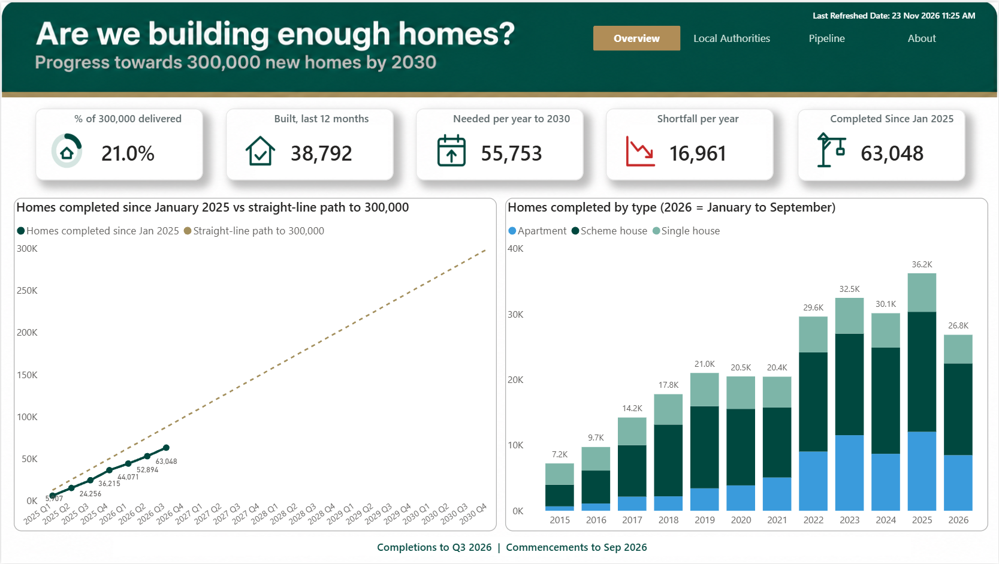
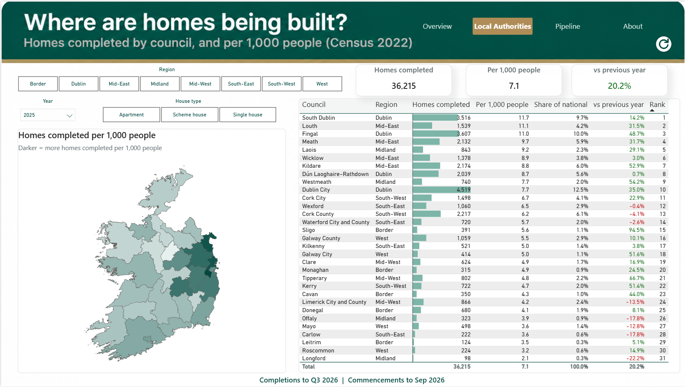
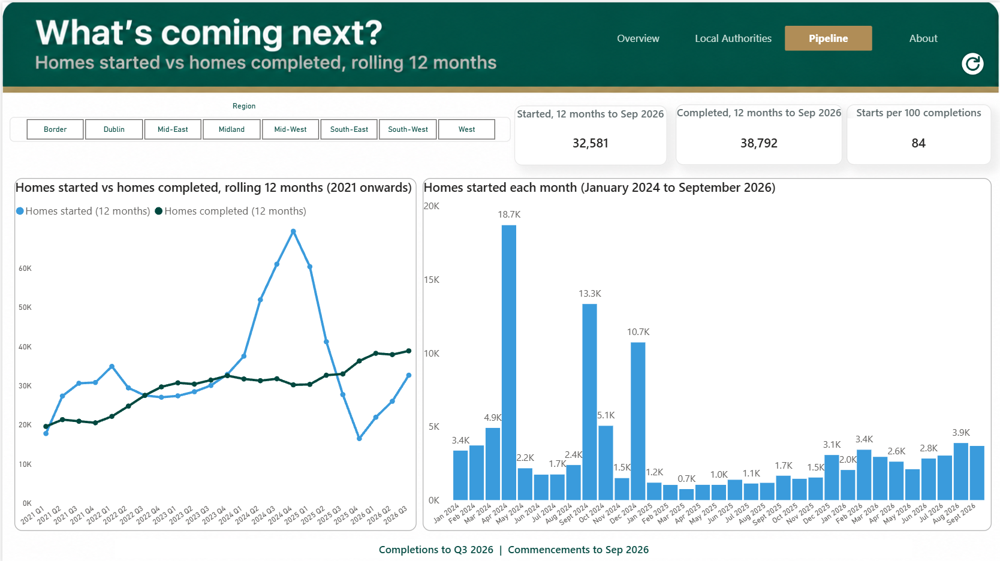
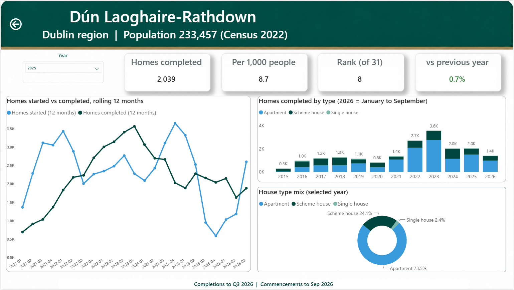
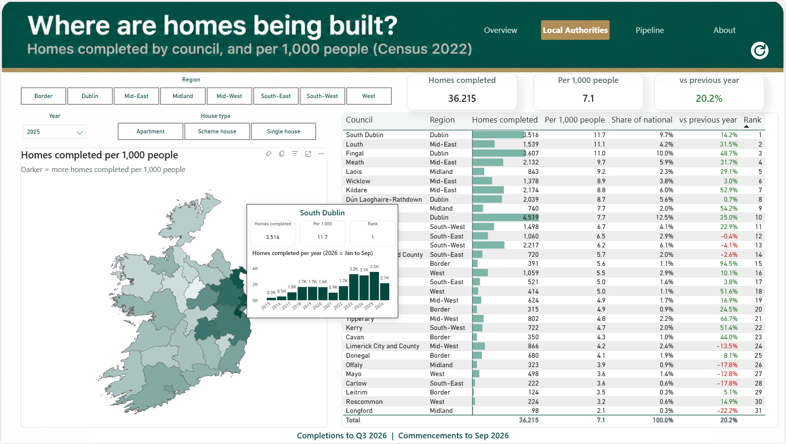
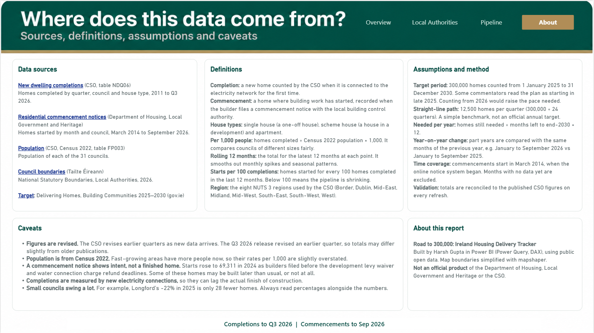

# Road to 300,000: Ireland Housing Delivery Tracker

A Power BI report tracking new home completions in Ireland against the national target of 300,000 homes by the end of 2030, built on live CSO and Department of Housing open data.

---

## Dashboard Preview

**Overview: Are we building enough homes?**

**Local Authorities: Where are homes being built?**

**Pipeline: What's coming next?**

**Council Detail (drill-through)**

**Council Tooltip**

**About: Where does this data come from?**

**Validation Check: Do the numbers reconcile?**

---

## Short Description

A 4-page Power BI report (plus 3 hidden pages) connected directly to CSO and Department of Housing open data. It tracks how many new homes are being completed, where they are being built, and whether enough homes are being started to keep delivery going, all measured against the government target of 300,000 new homes by 2030. A single refresh pulls in the latest release.

---

## Business Objective

The report answers four questions, one per page:

1. **Are we building enough homes?** Progress towards 300,000, the current build rate, and the rate needed to 2030
2. **Where are homes being built?** Completions by council, in total and per 1,000 people
3. **What's coming next?** Homes started vs homes completed, as a signal of future delivery
4. **Where does this data come from?** Sources, definitions, assumptions and caveats

---

## Tools Used

- Power BI Desktop
- Power Query (Web connector to the CSO PxStat API)
- DAX
- Data Modelling (Star Schema)
- Shape Map with a custom TopoJSON boundary file (simplified in mapshaper)

---

## Data Source

| Table | Rows | Description |
|-------|------|-------------|
| Completions | 5,859 | New homes completed by quarter, council and house type (CSO NDQ06) |
| Commencements | 4,681 | Homes started by month and council, from Commencement Notices (Department of Housing) |
| Local Authority | 31 | Council code, name, region and Census 2022 population (CSO FP003) |
| la_boundaries.json | 31 shapes | Council boundaries for the map (Tailte Éireann) |

Completions: Q1 2011 - Q3 2026 | Commencements: March 2014 - September 2026 | Councils: 31 | Licence: CC BY 4.0

Sources: [CSO NDQ06 New Dwelling Completions](https://data.gov.ie/dataset/ndq06-new-dwelling-completion) | [CSO FP003 Census 2022 Population](https://data.gov.ie/dataset/fp003-preliminary-population-2022) | [Department of Housing Residential Commencement Notices](https://opendata.housing.gov.ie/dataset/residential-commencement-notices) | [Tailte Éireann Open Data](https://data-osi.opendata.arcgis.com/)

---

## Data Preparation (Power Query)

- Removed the built-in total rows and columns ("Ireland", "All house types", "Total") so nothing is counted twice
- Unpivoted 12 monthly columns into rows and excluded the "Notices" metric, which counts paperwork rather than homes
- Found the latest month with data dynamically, so future months showing 0 don't look like a crash
- Matched commencement council names to CSO codes, with all 4,681 rows matched
- Simplified the boundary file from 9,161 polygons (113 MB) to 31 shapes (829 KB)
- Kept raw queries as untouched references with load disabled, and used Choose Columns so a new source column can't change the model

---

## Data Model

Star schema with two fact tables (`Completions`, `Commencements`) sharing two dimensions (`Date`, `Local Authority`):

- 4 one-to-many relationships, all single-direction
- Quarterly completions and monthly commencements both join to one daily `Date` table, so one Year slicer filters both
- Auto date/time turned off and `Date` marked as the date table
- About 30 explicit measures in a `_Measures` table
- A disconnected `Trend Years` table lets the tooltip always show the full history

---

## DAX Measures

| Measure | Expression | Description |
|---------|------------|-------------|
| Homes Completed | `SUM(Completions[Units])` | Total homes completed |
| Completions per 1,000 | `DIVIDE([Homes Completed], SUM('Local Authority'[Population 2022])) * 1000` | Fair comparison of large and small councils |
| Homes Completed PY | `SAMEPERIODLASTYEAR` applied only to dates up to the latest quarter with data | Compares the same months, avoiding the partial-year trap |
| Completed YoY % | `DIVIDE([Homes Completed] - [Homes Completed PY], [Homes Completed PY])` | Year-on-year change |
| Completed Since 2025 | `CALCULATE([Homes Completed], REMOVEFILTERS('Date'), 'Date'[Date] >= DATE(2025,1,1))` | Progress towards the target, unaffected by slicers |
| % of Target Delivered | `DIVIDE([Completed Since 2025], [Target Homes])` | Share of 300,000 delivered |
| Run Rate Needed | `DIVIDE([Homes Still Needed], [Months Remaining]) * 12` | Homes needed per year from now to end-2030 |
| Current Run Rate | `CALCULATE([Homes Completed], DATESINPERIOD('Date'[Date], [Completions Data End], -12, MONTH))` | Homes built in the last 12 months |
| Ahead or Behind Target | `IF(NOT ISBLANK([Cumulative Completed]), [Cumulative Completed] - [Target Trajectory])` | Gap to a straight-line path, guarded against future blanks |
| Completions Rank | `RANKX(ALL('Local Authority'), [Completions per 1,000], , DESC, Dense)` | Council rank out of 31 |
| Starts per 100 Completions | `DIVIDE([Commenced Last 12 Months], [Current Run Rate]) * 100` | Below 100 means the pipeline is shrinking |
| Data Note | `"Completions to Q" & QUARTER([Completions Data End]) & " " & YEAR([Completions Data End]) & ...` | Footer that updates itself on refresh |

---

## What I Built

- Overview page with 5 KPI cards, completions since 2025 vs a straight-line path to 300,000, and completions by house type
- Local Authorities page with a council map coloured by completions per 1,000, a ranked council table, and Year, Region and House type slicers
- Pipeline page with rolling 12-month homes started vs completed, and homes started each month
- Council Detail drill-through page with 4 cards, trend lines and the house type split for one council
- Report page tooltip showing a council's full history on hover
- About page with sources, definitions, assumptions and caveats
- Hidden Validation Check page reconciling model totals to published CSO figures
- Reset buttons (bookmarks), page navigator, alt text and accessible colour contrast

---

## Key Numbers (completions to Q3 2026, commencements to September 2026)

| Metric | Value |
|--------|-------|
| Completed since January 2025 | 63,048 (21.0% of 300,000) |
| Built, last 12 months | 38,792 |
| Needed per year to end-2030 | 55,753 |
| Shortfall per year | 16,961 |
| Behind the straight-line path | 24,452 |
| Started, last 12 months | 32,581 |
| Starts per 100 completions | 84 |
| 2026 so far vs same months 2025 | +10.6% |

---

## Key Findings

- Ireland is 21% of the way to 300,000 and is building about 17,000 fewer homes a year than the target needs
- Completions rose 20.2% in 2025 to 36,215, and 2026 is up 10.6% on the same months of 2025
- Dublin City completes the most homes (4,519 in 2025) but ranks only 10th of 31 per 1,000 people; South Dublin, Louth and Fingal lead per person
- 95.7% of Dublin City's 2025 completions were apartments, compared with 33.2% nationally
- Commencements jumped to 69,311 in 2024 ahead of the levy and water-charge waiver deadlines, then fell to 16,412 in 2025
- Only 84 homes are starting for every 100 completed, so the pipeline is thinning

---

## How to Use

1. Download `Ireland_Housing_Delivery_Tracker.pbix`
2. Open it in Power BI Desktop (data is already embedded)
3. To get the latest release, click **Home > Refresh**. It connects anonymously to the CSO and Department of Housing, so no sign-in is needed
4. Use the navigator buttons to move between pages
5. On Local Authorities, use the Year, Region and House type slicers; the reset icon restores the defaults
6. Hover over a council for its tooltip, or right-click it and choose **Drill through > Council Detail**

---

## Disclaimer

This is a personal portfolio project built on public open data. It is not an official product of the CSO or the Department of Housing, Local Government and Heritage.
